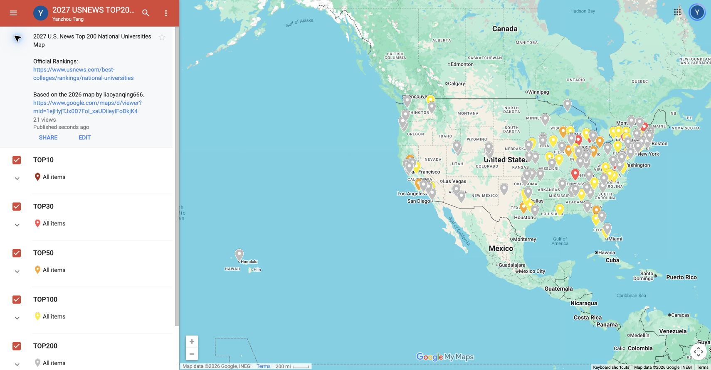

# 2027 U.S. News Top 200 National Universities Map

A map of **201 U.S. national universities ranked 200 or better** in the 2027 U.S. News Best Colleges rankings, including all ties.

[View the 2027 map](https://www.google.com/maps/d/u/0/viewer?mid=1yAEtqG9k-oBaHtPVAxzdGeHfrhGSr9w&ll=35.55365923502805%2C-114.375722&z=4) · [Official U.S. News rankings](https://www.usnews.com/best-colleges/rankings/national-universities)

## Original map and credit

Based on the [2026 map](https://www.google.com/maps/d/viewer?mid=1ejHyjTJx0D7FoI_xaUDileyIFoDkjK4) by **[liaoyanqing666 (聊言青)](https://github.com/liaoyanqing666)**. Credit to the original author for the map concept, five ranking groups and colors, most Chinese university names, and the 2026 ranking information used for comparison.

This edition was rebuilt with updated rankings and NCES institution coordinates. The generator was independently written. The author's [profile README](https://github.com/liaoyanqing666/liaoyanqing666) links to Google My Maps; no separate map source-code repository was found during preparation.



## Layers and university details

| Layer | Ranking range | Universities | Color |
|---|---|---:|---|
| TOP10 | 1–10 | 11 | `#A52714` |
| TOP30 | 11–30 | 19 | `#FF5252` |
| TOP50 | 31–50 | 21 | `#F9A825` |
| TOP100 | 51–100 | 57 | `#FFEA00` |
| TOP200 | 101–200 | 93 | `#BDBDBD` |

Layers are mutually exclusive. Ties produce 11 universities in the top 10 and 108 in the top 100. The last included ranking group is #191; the next group, #202, is outside the cutoff. This project covers **National Universities**, excluding liberal arts colleges, graduate programs, and global university rankings.

Each marker shows only `name`, `2027 USNEWS Ranking`, `Chinese name`, `English name`, `City / State`, and `2026 USNEWS Ranking`.

192 universities were matched to the original map. The other nine show `原图未收录` (“not included in the original map”) for 2026; this does not establish that they are newly ranked in 2027. Full provenance remains in the JSON, GeoJSON, and audit files.

## Build and use

Requires Python 3 and its standard library. From the repository directory, run:

```sh
python3 build_map.py
```

The build uses bundled data and requires no API key or network access. It validates school counts, unique NCES institution IDs, rank and coordinate consistency, coordinate ranges, KML marker counts, and the six-field marker structure.

| File | Purpose |
|---|---|
| `usnews-2027-top200.kml` | Complete map with five folders, for Google Earth and other KML software |
| `layers/*.kml` | Five separate layers for Google My Maps |
| `universities-2027.json` | All 201 enriched university records |
| `universities-2027.geojson` | Geographic features with the same records |
| `data/` | Ranking and coordinate inputs, matching notes, and validation records |
| `build_map.py` | Rebuilds the KML, JSON, and GeoJSON outputs |
| `manifest.json` | Map links, metadata, counts, and display fields |

To make your own Google My Maps copy, import `layers/TOP10.kml` into a new map, then add a layer for each remaining KML in `layers/`. KML folders may not become separate switchable layers in every application. Access to the hosted map depends on its Google My Maps sharing settings; the KML files in this repository can be downloaded independently.

## Data sources and validation

Data checked on **October 26, 2026**.

- **2027 rankings:** [XuanXiao National Universities](https://xuanxiao.org/en/rankings/usnews/regional/national-universities). All 201 rows came from this secondary compilation, rather than directly from U.S. News.
- **Release confirmation:** [U.S. News publisher press release, September 22, 2026](https://www.prnewswire.com/news-releases/mit-claims-no-1-spot-in-us-news-2027-best-colleges-rankings-302885278.html).
- **Ranking checks:** `data/ranking_validation.json` records 18 primary-source spot checks: 17 included universities and East Carolina University at #202. All agreed; these are not individual primary-source verification of every row.
- **Coordinates:** [NCES EDGE Postsecondary School Locations 2024–25](https://catalog.data.gov/dataset/postsecondary-school-locations-2024-25), U.S. Department of Education. All 201 locations were checked against institution IDs, states, and campus aliases. A registered institution location may differ from a campus center or visitor entrance.
- **2026 comparisons, Chinese names, and styling:** [Original map by liaoyanqing666](https://www.google.com/maps/d/viewer?mid=1ejHyjTJx0D7FoI_xaUDileyIFoDkjK4). Its public export supplied names and addresses without coordinates.

## License

`build_map.py` is available under the [MIT License](LICENSE-CODE.txt). Source datasets and third-party content retain their respective providers' rights; the code license does not grant additional rights to their data, names, trademarks, or branding.

This is an independently prepared map, unaffiliated with U.S. News.
